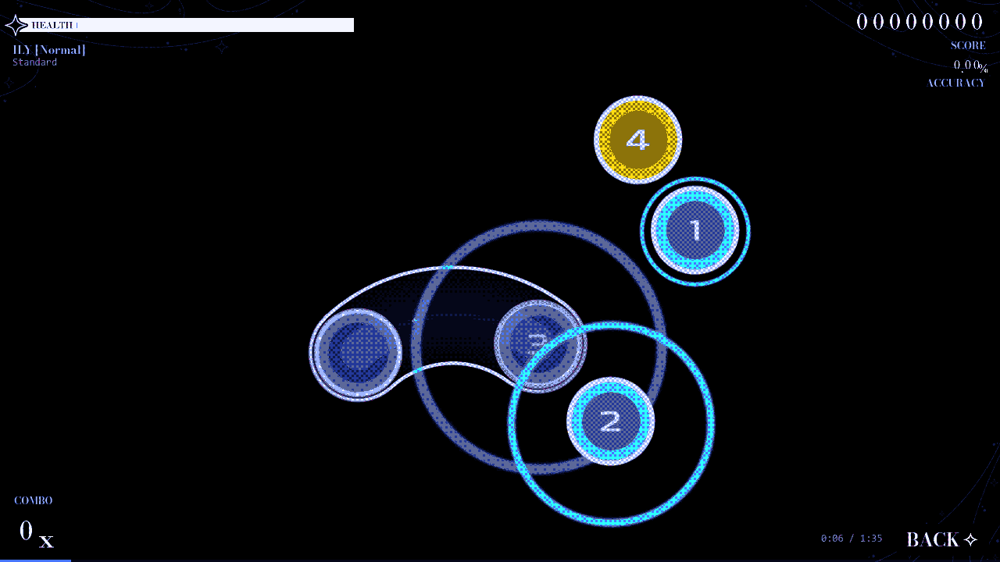
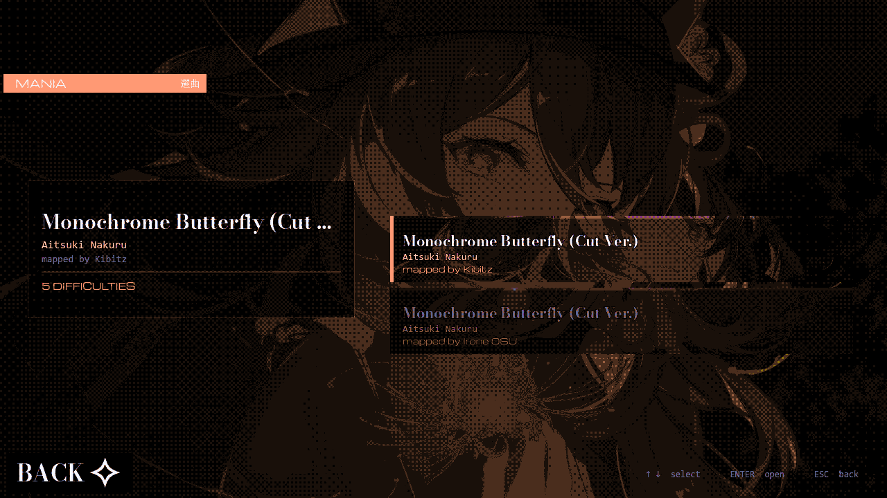

# Rhythm

An aesthetic osu!-style desktop rhythm game built with Godot 4 (GDScript). It plays real osu! beatmaps in two modes, **Standard** and **Mania**.

- Gameplay stays black with dithered notes and a minimal HUD.
- The whole screen runs through a real-time Bayer dither post-process that pulses on the beat. Colour, pattern and strength can be changed in Settings.
- Menus have an ASCII/Japanese flavour, and each map's background art sets the colour theme.
- An AI beatmap **Editor** generates Standard or Mania maps from a song with [Mapperatorinator](https://github.com/OliBomby/Mapperatorinator), running on your local GPU.




## Run it

1. Install [Godot 4.4 or newer](https://godotengine.org/download) (the standard build, not .NET).
2. In the Project Manager, click **Import** and pick this folder's `project.godot`.
3. Press **F5** to play.

To run it from a terminal, use `godot --path .`.

## Add maps

No maps or music come with the game. Drop osu! beatmaps into `beatmaps/`, either as `.osz` files or unpacked map folders. Song select unpacks `.osz` files the next time it opens. Only Standard (mode 0) and Mania (mode 3) maps are listed.

## Controls

- **Standard:** aim with the mouse and hit with Z/X or either mouse button. Hold through sliders and spin spinners.
- **Mania:** D F J K for 4K, S D F Space J K L for 7K. Other key counts use a symmetric layout around Space. F3/F4 change the scroll speed.
- **Menus:** arrow keys, Enter and Esc, or the mouse. During play, Esc pauses the game.

## AI Editor (optional)

The Editor needs the Mapperatorinator submodule and its own Python environment with CUDA PyTorch:

```sh
git submodule update --init third_party/Mapperatorinator
```

Then create `third_party/Mapperatorinator/.venv` and install CUDA torch and the requirements into it. [third_party/README.md](third_party/README.md) has the exact commands, and Mapperatorinator's README covers GPU-specific details. The model weights download from Hugging Face the first time you click Generate. The rest of the game works without any of this.

## Project layout

- `scenes/`, `scripts/`: screens, gameplay modes, `.osu` parsing, the HUD and the Editor
- `shaders/`: the dither post-process and the cursor shader
- `assets/`: fonts, theme, bundled hitsounds and the skin textures the game uses
- `tools/mapperatorinator_run.py`: the runner the Editor calls
- `docs/DESIGN.md`: design notes

## Credits and licensing

- Fonts: Michroma and Bodoni Moda, both under the SIL Open Font License (licence files are in `assets/fonts/`).
- Skin: `assets/skins/neptune/` comes from **Neptune**, a third-party osu! skin used here as placeholder art. It belongs to its author and is not covered by this repository. To swap it out, replace that folder with another osu! skin (see `scripts/core/skin_assets.gd`).
- The default hitsounds in `assets/sounds/hitsounds/` were synthesised for this project.
- [Mapperatorinator](https://github.com/OliBomby/Mapperatorinator) is MIT-licensed and is included as a submodule.
- osu! is a trademark of ppy Pty Ltd. This project is not affiliated with osu!. No beatmaps or music are included.
